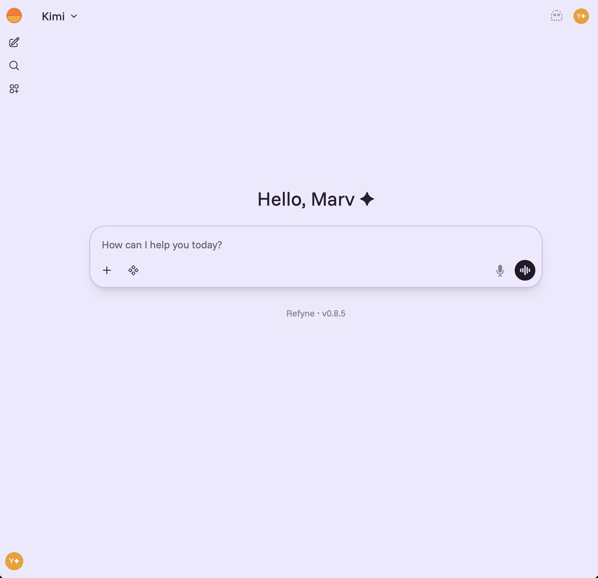
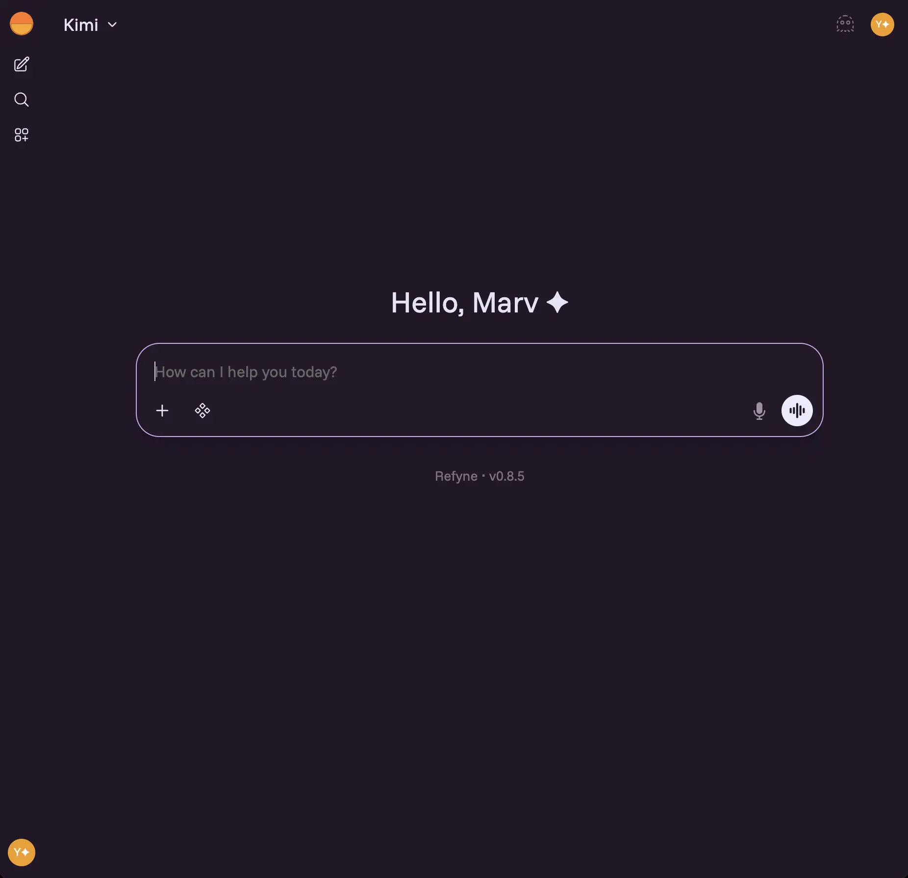

# Refyne ✨

An [Open WebUI](https://github.com/open-webui/open-webui) fork with a cleaner design and quality-of-life workflow improvements.

  
  &nbsp;&nbsp;
  

## What's Changed

### ✦ UX

- Custom theme for dark and light mode
- Cleaner UI with a scroll-hiding navbar
- Separate Enter-to-send settings for mobile and desktop
- Custom model cards, images, and greetings

### ⚙ Tech Stack

- Svelte, Tailwind CSS v4, and FastAPI
- npm with ESLint and Prettier
- Docker image published to `ghcr.io/stickyburn/refyne:latest` on pushes to `master`

## Development

Use Node.js 22 and Python 3.12. Install frontend dependencies with `npm ci`, then run `npm run dev`.
The frontend listens on port 5000 and proxies backend requests to `http://localhost:8080` by default.
Set `WEBUI_BACKEND_URL` to use a different backend address.

See the [upstream documentation](https://docs.openwebui.com/) for backend setup and configuration.

## Upstream updates

Refyne tracks stable Open WebUI releases. Back up the database and persistent data before upgrading.
For v0.13.0, upstream requires all instances to upgrade together because of database schema changes;
rolling updates are not supported.

## License

See [LICENSE](./LICENSE) and [LICENSE_HISTORY](./LICENSE_HISTORY) for the upstream license terms and history,
including Open WebUI branding requirements.

---

*Maintained by [stickyburn](https://www.linkedin.com/in/yashaank/)*
